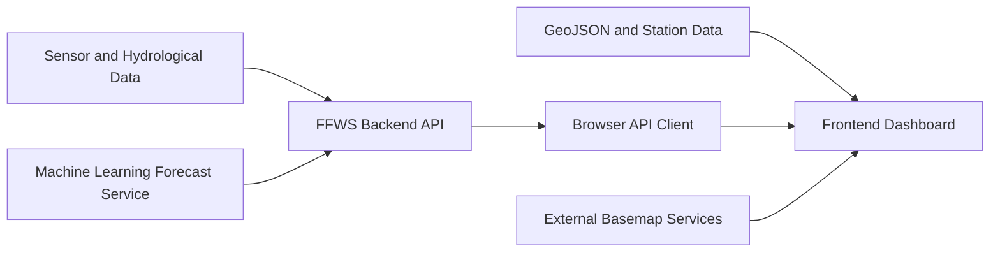

# Flood Forecasting Dashboard

A web-based dashboard for monitoring river conditions, water levels, rainfall, water quality, and flood risk in the Welang River Basin and Surabaya.


## Overview

Flood monitoring requires hydrological readings, forecast results, and geographic context to be reviewed together. This dashboard combines those inputs in an interactive map and station-detail pages.

The primary study area is the Welang River Basin in Pasuruan, East Java. The application also includes monitoring locations and river data for Surabaya. Users can inspect watershed boundaries, river networks, monitoring stations, simulated rainfall, water-level history, and short-term forecasts.

Welang currently uses historical Excel readings for Purwodadi and Dhompo; other Welang stations retain their map locations and show unavailable readings. Surabaya reads telemetry through a read-only collector. Both regions use a persistent MySQL archive for station charts and monthly Excel downloads. Prediction models and Telegram are disabled by default. The dashboard is intended for researchers and monitoring users and is not a validated operational warning system.

## Key Features

- Interactive watershed and river-network map
- Water-level monitoring with station status and history
- Optional forecast integration, disabled by default
- Rainfall and water-quality visualization
- Searchable stations with detailed monitoring pages

Additional monitoring and analysis features are under active development.

## Study Area

The Welang River Basin covers monitoring locations along the Welang river system in Pasuruan. The bundled station dataset contains 15 locations, including Dhompo near the downstream section. Each station record includes WGS84 coordinates and a coordinate-confidence label.

The map also includes Surabaya monitoring locations, the city river network, and East Java regional context. Watershed and administrative boundaries come from Badan Informasi Geospasial (BIG). River features come from OpenStreetMap and are clipped to the relevant study boundary.

## Data Sources

| Data | Source | Format | Usage |
|---|---|---|---|
| Welang watershed boundary | BIG Atlas Wilayah Sungai, object 11622 | GeoJSON | Watershed map layer |
| Administrative boundaries and river networks | BIG and OpenStreetMap contributors through Overpass API | GeoJSON | Regional context and river visualization |
| Elevation and station sub-watersheds | DEMNAS from BIG, processed with WhiteboxTools | Raster input and GeoJSON output | Local drainage delineation |
| Welang water level and rainfall | Operator-provided historical dataset | Excel | Historical observations; timestamp and source retained |
| Surabaya telemetry | Four configured read-only MySQL sources | MySQL / REST | Monitoring archive and station history |

## System Architecture



The static frontend consumes the monitoring REST API directly from the browser. The separate backend reads sensor databases, imports Welang Excel observations, and serves archived history and exports. Bundled GeoJSON and station files are loaded directly by the frontend.

## Technology Stack

- Next.js 16 and React 19
- TypeScript
- MapLibre GL for interactive maps
- Recharts for station history charts
- Static Next.js export served by Nginx

## Local Development

Requirements:

- Node.js 22
- npm

Install dependencies and start the development server:

```powershell
npm ci
npm run dev
```

Open `http://localhost:3000`.

The pre-development script copies the required MapLibre worker files to `public/vendor`.

## Production Build

```powershell
npm run build
npm start
```

`npm start` serves the static `out` directory on `127.0.0.1:3000`. Use `PORT` or `--port` to choose another port. This server serves files only; configure the API origin at build time or provide a same-origin reverse proxy for `/monitoring-api`.

The `Dockerfile` builds static HTML, CSS, and JavaScript and serves the `out` directory with Nginx on port 3000. Runtime data is fetched by the browser from FastAPI through `/monitoring-api`; no Next.js API server is required. Sensor references and water-level calculations are owned by FastAPI; the frontend only selects the API fields and converts display units.

### Container image registry

The `Build and Publish Docker Image` workflow (`.github/workflows/docker-publish.yml`)
builds the frontend image for `linux/amd64` and pushes it to the
GitHub Container Registry (GHCR):

```text
ghcr.io/somerandomdolphin/ffws-frontend
```

Images are published on pushes to `master` (tagged `latest`, `master`, and `sha-<short>`,
plus `vX.Y.Z` and `vX.Y` when a `v*` tag is pushed). Pull requests build the image
without pushing, and the workflow can also be started manually via `workflow_dispatch`.

Pull the published image with:

```powershell
docker pull ghcr.io/somerandomdolphin/ffws-frontend:latest
```

The workflow authenticates with the built-in `GITHUB_TOKEN`, so no extra secrets are
required. If the package visibility has not been set yet, open the package settings on
GitHub and grant the repository write access.

The image is built only for `linux/amd64`, which runs natively on the GitHub-hosted
runner. Revisit this if an arm64 deployment target is ever needed.

## Related Repositories

- [FFWS Frontend](https://github.com/SomeRandomDolphin/ffws-frontend)
- [FFWS Backend](https://github.com/SomeRandomDolphin/ffws-backend)
- [FFWS Machine Learning](https://github.com/SomeRandomDolphin/ffws-ml)

## Funding and Affiliation

This project is funded through a research program at Institut Teknologi Sepuluh Nopember (ITS) and developed by the Department of Civil Engineering.

The project supports government and research activities under the Flood Forecasting Warning System initiative.
